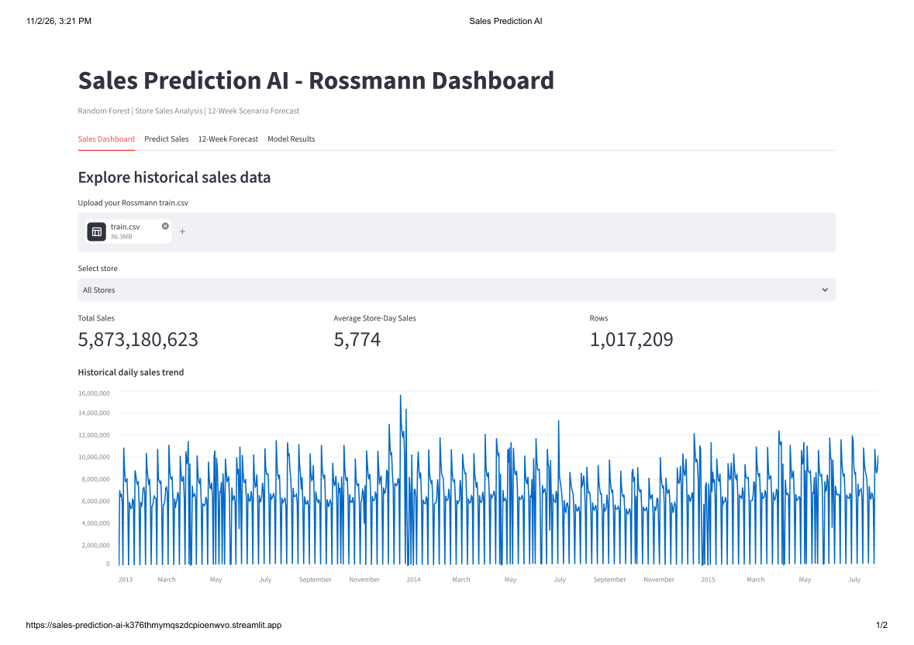
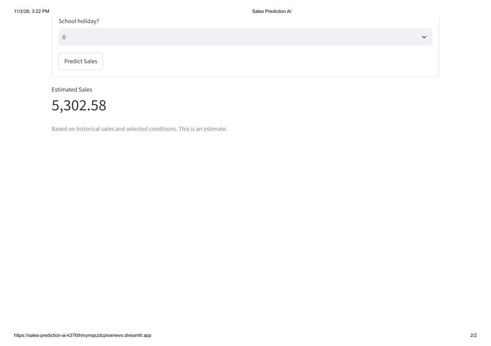
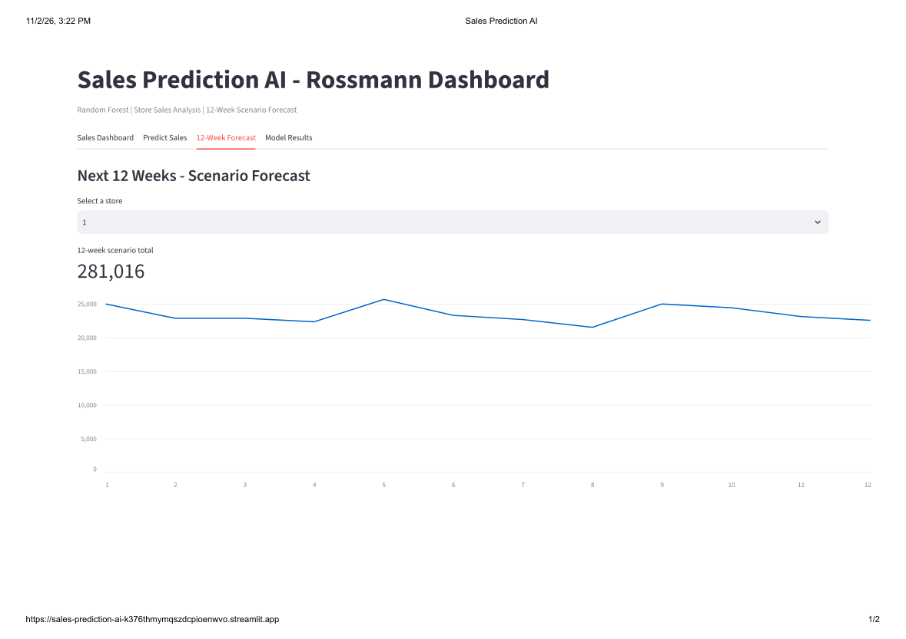
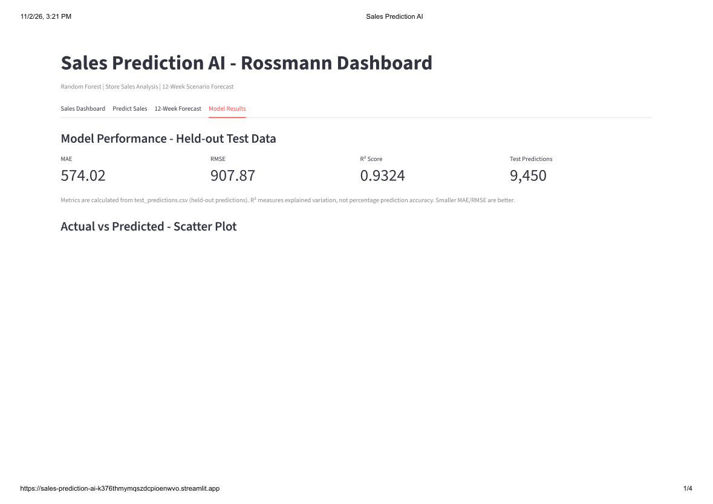

# 📈 Sales Prediction AI | Machine Learning & Streamlit Dashboard

### Retail Sales Prediction using Random Forest Regression

An end-to-end Machine Learning project that analyzes historical retail sales, predicts daily store sales, and provides 12-week sales forecasting scenarios through an interactive Streamlit dashboard.

**Technologies:** Python | Pandas | NumPy | Scikit-learn | Random Forest | Matplotlib | Streamlit

**Model Performance:**
- R² Score: 0.9324
- MAE: 574.02
- RMSE: 907.87

## Project Screenshots

### Sales Dashboard

### Sales Prediction

### 12-Week Forecast

### Model Results

## 🚀 Live Application

[Click Here to Explore Sales Prediction AI](https://sales-prediction-ai-k376thmymqszdcpioenwvo.streamlit.app/)
